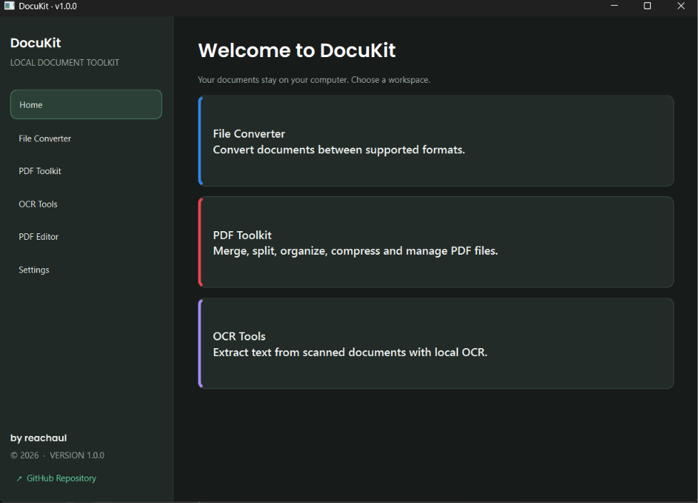
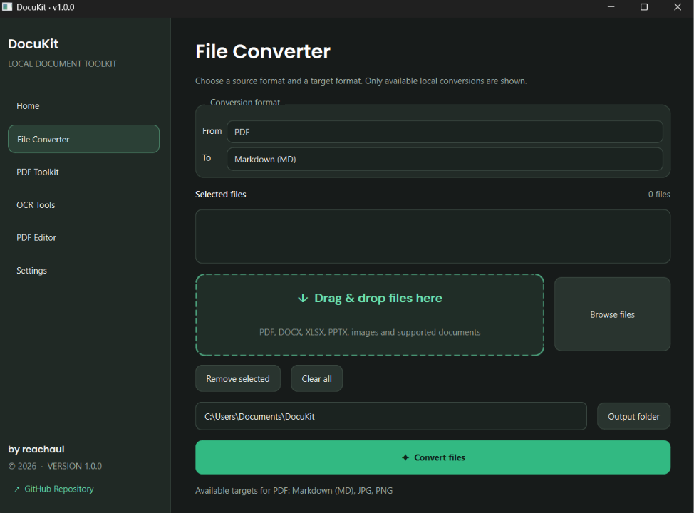
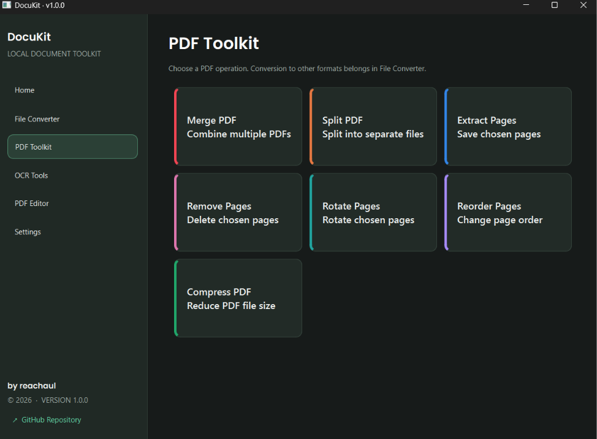

<div align="center">

# DocuKit

### Your Documents. Your Device. Your Privacy.

A privacy-focused desktop document toolkit for Windows.

Convert documents, manage PDFs, and handle your files locally — without uploading your documents to cloud services.

**Made with care by reachaul**

[Features](#features) · [Installation](#installation) · [Usage](#usage) · [Build](#building-from-source) · [Contributing](#contributing)

</div>

---

## About DocuKit

**DocuKit** is a Windows desktop application designed to make everyday document management easier, combining document conversion and PDF utilities in one place.

Built with **Python** and **PySide6**, DocuKit provides a modern desktop interface while keeping document processing on your own computer.

### Key Highlights

* **Privacy-focused** — Document processing is designed to happen locally on your device.
* **All-in-one toolkit** — Document conversion and PDF utilities in one application.
* **Modern interface** — Clean desktop UI with drag-and-drop and file browsing.
* **Offline-oriented** — No cloud upload is required for the application's core local processing features.

## Features

### 1. File Converter

Convert supported document and image formats.

| Conversion                        | Availability                              |
| --------------------------------- | ----------------------------------------- |
| PDF to JPG / PNG                  | Available                                 |
| JPG / PNG / WEBP to PDF           | Available                                 |
| JPG / PNG / WEBP image conversion | Available                                 |
| PDF to Markdown                   | Available with optional MarkItDown engine |
| DOCX to Markdown                  | Available with optional MarkItDown engine |
| XLSX to Markdown                  | Available with optional MarkItDown engine |
| PPTX to Markdown                  | Available with optional MarkItDown engine |
| HTML / CSV / TXT to Markdown      | Available with optional MarkItDown engine |

### 2. PDF Toolkit

Manage PDF documents with practical utilities:

* Merge PDF files
* Split PDF documents
* Extract selected pages
* Remove unwanted pages
* Rotate pages
* Reorder pages
* Compress and optimize PDF files

### 3. Additional Tools

The application interface also includes sections for OCR Tools and PDF Editor. These are planned for future development and are not yet available as functional tools in version 1.0.0.

## Technology Stack

* **Python 3.15** — Application development environment
* **PySide6** — Desktop graphical user interface
* **PyMuPDF** — PDF processing
* **Pillow** — Image processing
* **MarkItDown** — Optional document-to-Markdown conversion
* **PyInstaller** — Windows executable packaging

## Installation

### Requirements

* Windows 10 or Windows 11
* Python 3.15 for running from source

### 1. Clone the repository

```powershell
git clone https://github.com/reachaul/docukit.git
cd docukit
```

### 2. Create a virtual environment

```powershell
py -3.15 -m venv .venv
```

### 3. Install dependencies

```powershell
.\.venv\Scripts\python.exe -m pip install --upgrade pip
.\.venv\Scripts\python.exe -m pip install -r requirements.txt
```

### 4. Optional components

For additional document-to-Markdown conversion support:

```powershell
.\.venv\Scripts\python.exe -m pip install -r requirements-converter.txt
```

OCR dependencies can be installed separately. Tesseract OCR must also be installed on Windows. Note that the OCR interface is not yet functional in version 1.0.0.

```powershell
.\.venv\Scripts\python.exe -m pip install -r requirements-ocr.txt
```

## Usage

Run DocuKit from the project directory:

```powershell
.\.venv\Scripts\python.exe -m app.main
```

Once the application opens:

1. Select File Converter or PDF Toolkit.
2. Add files using Browse or drag-and-drop.
3. Select the desired operation.
4. Configure the available options.
5. Process and save the output to your chosen location.

## Building from Source

DocuKit uses PyInstaller to package the application for Windows.

Install the build dependencies:

```powershell
.\.venv\Scripts\python.exe -m pip install -r requirements-converter.txt
.\.venv\Scripts\python.exe -m pip install -r requirements-build.txt
```

Build the application:

```powershell
.\.venv\Scripts\pyinstaller.exe --clean --noconfirm DocuKit.spec
```

The build output is generated in:

```text
dist/DocuKit/
```

The resulting build should be tested on a separate Windows environment before distribution.

## Project Status

| Component                       | Status    |
| ------------------------------- | --------- |
| File Converter                  | Available |
| PDF Toolkit                     | Available |
| OCR Tools                       | Planned   |
| PDF Editor                      | Planned   |
| Windows executable distribution | Pending   |

DocuKit is currently at **version 1.0.0**.

## Privacy

DocuKit is designed around local document processing.

Your documents are processed on your computer rather than uploaded to a cloud service by the application's core processing workflow.

Optional components and their dependencies may have separate installation requirements.

## Contributing

Contributions, suggestions, and bug reports are welcome.

If you find a bug or have an idea for improvement:

1. Open an issue describing the problem or suggestion.
2. Provide steps to reproduce bugs where possible.
3. Submit a pull request if you would like to contribute code.

Please read [CONTRIBUTING.md](CONTRIBUTING.md) before submitting changes.

## License

This project is licensed under the **MIT License**. See [LICENSE](LICENSE) for details.

---

<div align="center">

**DocuKit**

Your Documents. Your Device. Your Privacy.

Made with care by **reachaul**

© 2026 · Version 1.0.0

</div>

## Screenshots

### Home


### File Converter


### PDF Toolkit
